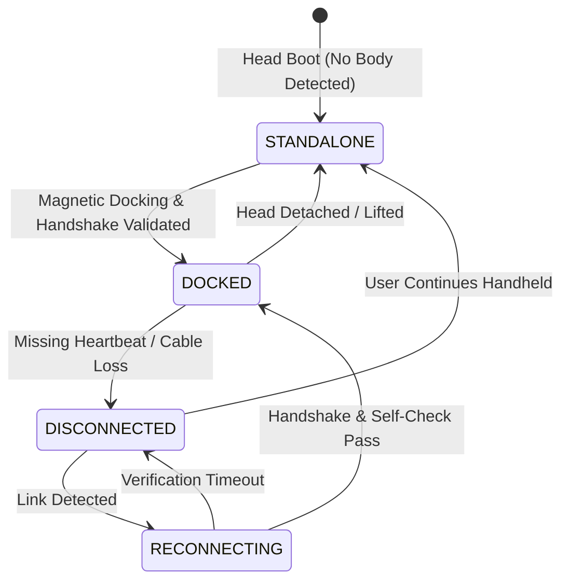

# AI Desk Companion: Modular AI Companion Robot with Detachable Head
## Complete Project Report & Frontend/Backend Technical Specification
**Document Version:** 2.0 (Modular Architecture Edition)  
**Classification:** Major Project Design & Technical Specification  
**Architecture:** Detachable Standalone AI Head ("Muse Mode") + Wheeled Robotic Mobility Body ("Desk Companion Mode")

---

# Table of Contents
1. [Executive Summary](#1-executive-summary)
2. [Problem Identification and Definition](#2-problem-identification-and-definition)
3. [Project Objectives and Scope](#3-project-objectives-and-scope)
4. [Requirement Analysis (Functional & Non-Functional)](#4-requirement-analysis)
5. [Literature Survey & Design Benchmarking](#5-literature-survey)
6. [Concept Formulation and Modular Architecture](#6-concept-formulation)
7. [Hardware Specification and Power Strategy](#7-hardware-specification)
8. [Software Architecture and Head–Body Link (BodyLink Protocol)](#8-software-architecture)
9. [Safety, Privacy, and Failure Handling](#9-safety-privacy-and-failure-handling)
10. [Preliminary Project Plan and Methodology](#10-preliminary-project-plan)
11. [Testing, Validation, and Acceptance Matrix](#11-testing-and-validation)
12. [Risks, Honest Limitations, and Future Work](#12-risks-and-limitations)
13. [Complete Frontend Screen Inventory & UI Functionality (Screens 0–15)](#13-complete-frontend-specification)
14. [Backend Services, Data Models, & API Contracts](#14-backend-services-and-api-contracts)
15. [WebSocket Real-Time Event Contracts & Client State Machines](#15-websocket-and-state-management)

---

# 1. Executive Summary

The **AI Desk Companion** is an embodied AI assistant engineered for engineers, computer science students, researchers, and desk-based knowledge workers who navigate both physical desk materials (printed books, circuit prototypes, handwritten notes) and digital workspaces (codebases, terminals, project managers). 

Unlike pure smartphone voice assistants that lack embodied presence and desk awareness, or monolithic wheeled robots that cannot be brought up to inspect a book, the revised architecture introduces a **two-module physically detachable system**:

```
+--------------------------------------------------------------------------+
|                       UPPER HEAD MODULE ("MUSE MODE")                    |
|  - Standalone Handheld AI Device (Meta Muse Charm inspired)              |
|  - Compute: Raspberry Pi 5 (4-8 GB)                                      |
|  - Display: 2.8"–3.5" IPS Screen (Animated Eyes, Expressions, HUD)       |
|  - Vision: 12 MP Autofocus Camera (Sony IMX708 / Camera Module 3)        |
|  - Audio: ReSpeaker Mic Array (Beamforming + VAD) & Integrated Speaker   |
|  - Power: Independent 5V/5A Protected Battery Pack + USB-C Charging      |
|  - Privacy: Hard Mechanical Camera & Mic Cutoff Switch + Physical LED    |
+--------------------------------------------------------------------------+
                                     |
               MAGNETIC DOCKING INTERFACE (Keys/Pins + Hall Sensor)
               PROTOTYPE DATA LINK: Standard USB-C Serial Link (115200)
                                     |
+--------------------------------------------------------------------------+
|                       LOWER BODY MODULE ("ROBOT MODE")                   |
|  - Mobility & Actuation Base (Desk-Scale Movement & Gestures)            |
|  - Microcontroller: RP2040 Pico / ESP32-S3 (Deterministic Real-Time)     |
|  - Actuators: 2x Arm Servos (Waving, Pointing, Nudging)                  |
|  - Mobility: 2x DC Gear Motors + Ball Caster (Differential Drive)        |
|  - Safety: 2x Downward IR Cliff Sensors (Edge Drop-off Interlock)        |
|  - Power: Isolated Secondary Battery Rail (Motor Transient Isolation)    |
|  - Safety Watchdog: Independent 500ms Hardware Heartbeat Cutoff          |
+--------------------------------------------------------------------------+
```

### Core Design Principle
**The Head must remain fully useful and functional when detached; the Body must remain failsafe and inert when the Head, cable, application, or network is unavailable.**

---

# 2. Problem Identification and Definition

## 2.1 Problem Statement
Knowledge workers, engineering students, and embedded software developers spend hours at workbenches switching between digital tools (VS Code, terminals, Slack, documentation) and physical workspace artifacts (printed schematics, resistor color codes, breadboards, textbooks). Existing solutions present severe frictions:
1. **Smartphone/Smart Speaker Assistants**: Blind to desk objects; incapable of physical orientation; require repetitive descriptions of components.
2. **Monolithic Desk Robots**: Bulky bases (500g–1.2kg) cannot be picked up and held close to read small textbook formulas or inspect circuit pins without clumsy manual handling or risking knocks to breadboard wiring.
3. **Black-box Cloud AI Agents**: Lack direct physical safety interlocks; lack transparency into what files or tools are being edited.

## 2.2 Target Users and Operating Environment
- **Target Users**: Embedded systems engineers, CS students, hardware hackers, and knowledge workers.
- **Environment**: Standard office desks and lab benches (typically 60 cm × 90 cm to 80 cm × 150 cm) cluttered with laptops, monitors, circuit breadboards, and notebooks. Edge drop-offs represent an immediate physical hazard.

## 2.3 Why Modularity Matters
Decoupling the head from the body yields three transformative engineering benefits:
1. **Ergonomic Dexterity**: The user can lift the 160g head with one hand to scan an angled page, inspect an electronic component in a vise, or use it on the couch ("Muse Mode").
2. **De-risked Development Milestones**: The Head alone represents a complete, shippable conversational AI product. If chassis, motor tuning, or 3D printing of the body slips, the project still possesses a complete working demo.
3. **Electrical & Thermal Isolation**: The high-frequency compute load and sensitive mic/camera sensors are isolated from inductive motor transients, servo stall currents, and mechanical vibration.

## 2.4 Scope Boundaries for Version 1
- **Supported**: Desk-scale planar mobility, gesture pointing/waving, on-demand optical inspection, conversational voice loop, and local software integration (VS Code, terminal, Notion).
- **Explicitly Excluded from v1**: Room-scale navigation, stair climbing, robotic arm grasping/carrying, cellular modem 5G (phone hotspot is used instead), and ungrounded continuous video recording.

---

# 3. Project Objectives and Scope

1. **Standalone Head**: Build a self-contained, battery-powered upper module executing local wake-word, local STT/TTS, cloud LLM reasoning (Groq Llama-3.3-70B), animated face display, and IMX708 camera inspection.
2. **Mechanically Keyed Dock**: Construct an alignment-pin magnetic dock resisting lateral shear forces with an integrated dock sensor (Hall effect / microswitch).
3. **Safe Real-Time Robotic Body**: Construct a wheeled lower chassis with dual IR cliff drop sensors and arm servos, controlled by an independent RP2040/ESP32 running a fail-safe 500ms hardware watchdog.
4. **Transport-Independent BodyLink Protocol**: Implement a packetized JSON serial protocol over USB-C that gracefully handles hot-plug attach, detach, and reconnect states.
5. **Hardware Privacy Cutoff**: Provide a physical electrical switch cutting VBUS to the camera and mic hardware rails, physically preventing snooping regardless of software state.

---

# 4. Requirement Analysis

## 4.1 Functional Requirements Matrix

| ID | Module | Functional Requirement | Acceptance Criteria |
| :--- | :--- | :--- | :--- |
| **FR-01** | Head | Standalone Operation | Full conversational voice loop and animated eye states operate with Body absent. |
| **FR-02** | Head | On-Demand Multimodal Vision | Camera activates only upon explicit user trigger; identifies components and text. |
| **FR-03** | Head | Tap-to-Talk & Wake-Word | Supports "Hey Companion" wake-word or capacitive/hardware tap-to-talk in handheld mode. |
| **FR-04** | Link | Dock State Detection | Head accurately reports `STANDALONE`, `DOCKED`, `DISCONNECTED`, and `RECONNECTING` states. |
| **FR-05** | Link | Capability Negotiation | Body transmits version and actuator manifests; Head adjusts LLM tool definitions accordingly. |
| **FR-06** | Body | Bounded Physical Motion | Body executes speed-clamped, timeout-bounded movement (`v_max <= 0.25 m/s`, `duration <= 1000ms`). |
| **FR-07** | Body | Independent Cliff Interlock | IR edge drop sensor trips immediately inhibit wheel drive motors in firmware within 15ms. |
| **FR-08** | Body | Heartbeat Watchdog | Missing heartbeat (>500ms) or disconnected cable stops all motors and servos immediately. |
| **FR-09** | Head | Hardware Privacy Cutoff | Physical switch electrically interrupts camera/mic power; software returns `CAMERA_HARDWARE_DISABLED`. |
| **FR-10** | Head | Battery Fuel Gauge & Shutdown | Head monitors battery voltage over I2C; saves state and shuts down cleanly at 5% threshold. |

## 4.2 Non-Functional Requirements Matrix

| Attribute | Specification | Verification Method |
| :--- | :--- | :--- |
| **Safety** | Zero uncommanded motion at boot; firmware stops if head detached. | Bench disconnect test during forward drive. |
| **Voice Latency** | End-to-end voice latency (speech end to first audio token) < 2.5s. | Automated audio timestamp logging over 30 test prompts. |
| **Thermal Budget** | Head enclosure exterior temperature < 42°C during sustained load. | Thermal probe during continuous 30-minute Groq voice loops. |
| **Modularity Cycle** | Magnetic dock withstands >= 500 detach/attach cycles without wear. | Physical fatigue testing of pins and magnetic ledge. |
| **Privacy Assurance** | Zero continuous video or audio streaming to cloud servers. | Wireshark packet capture audit in idle mode. |

---

# 5. Literature Survey & Design Benchmarking

| Prior Art / Standard | Key Architectural Characteristics | Takeaway for AI Desk Companion |
| :--- | :--- | :--- |
| **Meta Muse Charm** | Palm-sized wearable AI device, ~2" screen, fingerprint tap-to-talk, cellular/Wi-Fi link. | Confirms handheld companion ergonomics: small screen for avatar feedback + physical tap-to-talk. |
| **Vector / Cozmo (Anki/DDL)** | Monolithic tracked companion robot, OLED face, lift arm, IR drop sensors, local CV. | Monolithic base prevents picking up the camera to inspect books; drop sensors are mandatory for table survival. |
| **Raspberry Pi 5 Power Guidelines** | Requires 5V @ 5A (25W) for full peripheral load; brownouts cause SD card corruption. | Head battery must use high-discharge 21700/18650 cells with dedicated synchronous boost regulation. |
| **USB Type-C Specification** | Standardized 24-pin connector with CC lines; strict VBUS protocols. | Prototype must use standard USB serial over standard cables; never repurpose USB-C pins with custom pinouts. |

---

# 6. Concept Formulation and Modular Architecture

```
                                    +--------------------+
                                    | User Voice / Tap   |
                                    +--------------------+
                                              |
                                              v
+-----------------------------------------------------------------------------------------+
|                               HEAD SUBSYSTEM (Raspberry Pi 5)                           |
|                                                                                         |
|  [Hardware Controls]          [Audio / Vision Pipeline]       [Cognitive Core]          |
|  - Physical Privacy Switch    - Local openWakeWord            - Groq Llama-3.3-70B      |
|  - Battery I2C Fuel Gauge     - faster-whisper STT            - Situational Rules       |
|  - Tap-to-Talk Sensor         - OpenCV IMX708 Vision          - SQLite Memory Store     |
|                               - Piper / Edge-TTS Engine       - ReAct Agent Runtime     |
|                                                                                         |
|                        +----------------------------------+                             |
|                        | BodyLink Transport & Mode Manager|                             |
|                        +----------------------------------+                             |
+-----------------------------------------------------------------------------------------+
                                         |  (Serial Packets over USB-C / Pogo)
                                         v
+-----------------------------------------------------------------------------------------+
|                               BODY SUBSYSTEM (RP2040 Pico / ESP32)                      |
|                                                                                         |
|  [Command Decoder]            [Safety Subsystem]              [Actuator Drivers]        |
|  - JSON Packet Validator      - 500ms Hardware Watchdog       - PWM Arm Servos (L/R)    |
|  - Capability Publisher       - Dual IR Edge Cliff Sensors    - Dual H-Bridge Motor PWM |
|  - ACK / Telemetry Generator  - Thermal / Overcurrent Trip    - Neck Pan/Tilt Pivot     |
+-----------------------------------------------------------------------------------------+
```

### Module Responsibilities
- **Head Module**: Sole cognitive authority. Performs audio capture, speech recognition, LLM reasoning, speech synthesis, and face rendering. If detached, gestures fall back to on-screen animations or vocalized descriptions.
- **Body Module**: Real-time mechanical servant. Executes bounded motor commands, streams IR cliff telemetry, and enforces fail-safe cutoffs. It has no direct access to internet, microphone, or camera.

---

# 7. Hardware Specification, Dimensions and Mechanical Strategy

## 7.1 Orthographic Dimensions & Weight Budget

```
+-----------------------------------------------------------------------------------------+
|                               ORTHOGRAPHIC SPECIFICATIONS                                |
+-----------------------------------------------------------------------------------------+
|  Total Height:       270 mm (Head to Sole Base)                                         |
|  Total Width:        160 mm (Foot-to-Foot Span); Head Width: 180 mm                     |
|  Total Depth:        150 mm (Foot Depth); Head Depth: 140 mm                            |
|  Total System Mass:  750 g – 1,150 g (Complete Assembly)                                |
+-----------------------------------------------------------------------------------------+
|                                3-TIER MODULE BREAKDOWN                                  |
+-----------------------------------------------------------------------------------------+
|  Module 1: Head Module (Standalone AI Companion)     | 250 g – 350 g                    |
|  Module 2: Body / Torso Module (Actuators & MCU)     | 300 g – 450 g                    |
|  Module 3: Dual Leg & Foot Modules (Structural Base) | 200 g – 350 g (Pair)             |
+-----------------------------------------------------------------------------------------+
|                                INDUSTRIAL FINISH OPTIONS                                 |
+-----------------------------------------------------------------------------------------+
|  1. Matte White     | Clean & minimal aesthetic with cyan accent ring illumination       |
|  2. Graphite Gray   | Modern, premium anodized finish with contrast dark accents         |
|  3. Sage Green      | Subtle, organic desk palette with playful cyan visor highlights    |
+-----------------------------------------------------------------------------------------+
```

## 7.2 Subsystem Bill of Materials (BOM)

| Subsystem | Component | Engineering Specification | Role & Interface |
| :--- | :--- | :--- | :--- |
| **Head (Brain)** | **Compute SBC** | Raspberry Pi 5 (4GB / 8GB RAM, Broadcom BCM2712) | Linux host, Groq LLM orchestration, local STT/TTS pipelines. |
| **Head (Brain)** | **Face Display** | 2.8" IPS LCD Capacitive Touch (480×320 / 640×480) | Animated eye emotions, status HUD, touch-to-talk input. |
| **Head (Brain)** | **Wide-Angle Vision** | 1080p Camera (120° FOV, Autofocus, Sony IMX708) | Desk inspection, OCR text reading, schematic identification. |
| **Head (Brain)** | **Microphone Array**| Far-field 2-Mic Beamforming Array with VAD | 16kHz PCM audio capture with ambient room noise suppression. |
| **Head (Brain)** | **Audio Speaker** | 3W 8Ω Enclosed Micro Speaker + MAX98357A I2S Amp | Clear vocal synthesis and interactive audio feedback. |
| **Head (Brain)** | **Thermal System** | Active Cooler (Copper heatsink + PWM blower fan) | Keeps exterior enclosure < 42°C under sustained Groq loops. |
| **Head (Brain)** | **Head Battery** | Protected Li-ion Pack (2000–3000 mAh, 3.7V/5V Boost) | 1.5–2.5h standalone handheld Muse runtime with fuel gauge. |
| **Head (Brain)** | **Privacy Controls**| Physical Mechanical Slide Switch + Status LED | Hard electrical power interruption to camera sensor and mic. |
| **Docking Interface**| **Pogo / USB-C Dock** | 5 Gold-plated Pogo Pins + Asymmetric Keyed Pins | Spring-loaded power (5V/GND) and bidirectional data (TX/RX). |
| **Docking Interface**| **Magnetic Hold** | 4x Neodymium N52 Ring Magnets (12N retention) | Strong tool-less dock hold with shear alignment keys. |
| **Docking Interface**| **Dock Detector** | Hall Effect Sensor + Magnet Target | Instantaneous detection of attach/detach for mode switching. |
| **Body (Torso)** | **Torso Controller**| ESP32-S3 / RP2040 Dual-Core MCU (133–240 MHz) | Microsecond PWM servo control, watchdog, sensor telemetry. |
| **Body (Torso)** | **Shoulder Servos** | 2x Metal-Gear Micro Servos (Left & Right) | 2-DOF Motion: Forward/Back pitch & Up/Down sweep. |
| **Body (Torso)** | **Elbow Servos** | 2x Metal-Gear Micro Servos (Left & Right) | Precise rotational articulation for pointing and waving. |
| **Body (Torso)** | **Soft Grippers** | Dual Rubberized Object-Safe End-Effectors | Expressive grasping and physical desk object nudging. |
| **Body (Torso)** | **Power Rail** | Dedicated 2S LiPo (7.4V, 2500 mAh) + 6V LDO Regulators| Complete electrical isolation preventing motor brownout reboots. |
| **Legs & Feet** | **Structural Legs** | Aluminum + ABS Hollow Frame with Internal Routing | Rigid structural support with concealed power/signal cables. |
| **Legs & Feet** | **Wide Stable Feet**| Low-profile Wide Base + High-traction Rubber Soles | 160mm × 150mm stance preventing tipping during arm gestures. |
| **Legs & Feet** | **Stability Sensors**| Dual 3-axis IMU / Load Feedback Sensors | Verifies table balance and detects desk tilt or lift events. |

## 7.2 Power Budget and Thermal Strategy

```
HEAD POWER BUDGET (Pi 5 Under Workloads)
-----------------------------------------------------------------
State                  Average Current (5V)   Power (W)   Est. 5000mAh Runtime
Idle (Screen Dim)      750 mA                 3.75 W      ~4.8 hours
Listening (VAD Active) 950 mA                 4.75 W      ~3.8 hours
Speaking (TTS Active)  1400 mA                7.00 W      ~2.6 hours
Vision Query (Peak)    2600 mA                13.00 W     (Short bursts)
Thermal Mitigation: Raspberry Pi Active Cooler with copper heatsink & PWM blower;
Head enclosure 3D-printed in heat-resistant PETG with chimney convective vents.
```

---

# 8. Software Architecture and Head–Body Link (BodyLink Protocol)

## 8.1 Mode Manager State Machine

The Head maintains a deterministic state machine managing transition between operating contexts:



- **STANDALONE ("Muse Mode")**:
  - Head operates as a handheld voice & vision assistant.
  - Body commands are strictly disabled.
  - Requested physical gestures automatically fall back to on-screen animations or vocalized descriptions.
- **DOCKED ("Robot Mode")**:
  - Handshake validates protocol compatibility (`v1.0`) and sensor readiness.
  - Head routes validated movement and arm gesture commands to Body MCU.
- **DISCONNECTED / FAULT**:
  - Body MCU firmware immediately cuts motor PWM (`emergency_stop()`).
  - Head UI displays movement disabled alert.

## 8.2 BodyLink Serial Packet Specification

All packets exchanged between Head and Body over the USB-C serial link (`115200 baud, 8N1`) are single-line newline-terminated (`\n`) JSON strings.

### Packet Types

```json
// 1. HELLO / Handshake (Sent by Body upon connection)
{"t": "HELLO", "protocol": "1.0", "firmware": "pico_v1.4", "mcu": "RP2040"}

// 2. CAPABILITIES (Sent by Body)
{"t": "CAPS", "motors": 2, "servos": ["arm_left", "arm_right", "head_tilt"], "sensors": ["ir_edge_left", "ir_edge_right"]}

// 3. HEARTBEAT (Exchanged bidirectionally every 200ms)
{"t": "PING", "seq": 1042}
{"t": "PONG", "seq": 1042, "battery_v": 6.2, "edge_clear": true}

// 4. COMMAND (Dispatched by Head to Body)
{
  "t": "CMD",
  "id": "cmd_9901",
  "action": "DRIVE",
  "params": {"left": 0.3, "right": 0.3, "duration_ms": 400},
  "timeout_ms": 500
}

// 5. ACK / REJECT (Returned by Body)
{"t": "ACK", "id": "cmd_9901", "status": "COMPLETED"}
{"t": "REJECT", "id": "cmd_9901", "reason": "CLIFF_SENSOR_TRIPPED"}
```

---

# 9. Safety, Privacy, and Failure Handling

## 9.1 Fail-Safe Safety Matrix

| Failure Event | Detection Point | Automated System Response | Recovery Action |
| :--- | :--- | :--- | :--- |
| **Desk Edge Approached** | Body IR cliff sensor trips | Firmware hardware interrupt cuts motor H-bridge within 15ms. | Body reverses 20mm away from edge; reports `CLIFF_TRIP` to Head. |
| **Head Detached While Moving** | Dock Hall sensor opens / VBUS drops | Body firmware watchdog expires within 500ms; all motors brake. | Movement halts permanently until clean redock and manual re-enable. |
| **Pi 5 Software Crash / Hang** | Heartbeat packet ceases | Body watchdog timer reaches 500ms timeout; motors shut down. | Controller enters safe passive state; zero uncommanded motion. |
| **Low Head Battery (<5%)** | I2C fuel gauge interrupt | Head displays low battery warning, persists SQLite context, clean shutdown. | Connect USB-C charger to Head module. |
| **Physical Privacy Switch Flipped** | Hardware SPDT switch | Breaks electrical VBUS supply to camera & mic modules. | Software displays red `HARDWARE_CUTOFF` banner; API returns 403. |

---

# 10. Preliminary Project Plan and Methodology

## 10.1 Six-Phase Implementation Roadmap

```
+-----------------------------------------------------------------------------------+
| Phase 1: Core Voice & Cognitive Loop (Month 1)                                   |
| - Bench Pi 5 OS configuration, mic/speaker verification                           |
| - Groq Llama-3.3-70B API integration, faster-whisper STT, Piper TTS               |
| - Exit Criteria: Stable end-to-end conversational voice loop on desk bench.       |
+-----------------------------------------------------------------------------------+
                                         |
                                         v
+-----------------------------------------------------------------------------------+
| Phase 2: Standalone Head Module ("Muse Mode") (Months 2–3)                        |
| - Integrated IPS animated eye face, Sony IMX708 autofocus camera                 |
| - 21700 battery power supply, I2C fuel gauge, physical privacy switch             |
| - Exit Criteria: Head operates completely untethered as a handheld AI device.    |
+-----------------------------------------------------------------------------------+
                                         |
                                         v
+-----------------------------------------------------------------------------------+
| Phase 3: Lower Body Firmware & Safety Watchdog (Months 3–5)                       |
| - RP2040/ESP32 firmware, DRV8833 motor drive, SG90 arm servos                     |
| - IR cliff drop sensors and hardware watchdog timer                               |
| - Exit Criteria: Bench verification of bounded motion and cliff stopping.        |
+-----------------------------------------------------------------------------------+
                                         |
                                         v
+-----------------------------------------------------------------------------------+
| Phase 4: Magnetic Dock & BodyLink Protocol (Months 5–7)                           |
| - 3D-printed keyed magnetic dock, USB-C serial link, Hall dock sensor             |
| - Mode Manager state transitions (Standalone vs. Docked)                          |
| - Exit Criteria: Seamless hot-plug docking/undocking with instant fail-safes.     |
+-----------------------------------------------------------------------------------+
                                         |
                                         v
+-----------------------------------------------------------------------------------+
| Phase 5: Agentic Workstation & Vision Studio (Months 7–9)                         |
| - Multimodal document & electronic component inspection                           |
| - Software integrations: VS Code buffer monitor, Terminal runner, Slack, Notion   |
| - Exit Criteria: Full workstation HUD operating in Dual-Mode.                     |
+-----------------------------------------------------------------------------------+
                                         |
                                         v
+-----------------------------------------------------------------------------------+
| Phase 6: System Hardening & Validation (Months 10–12)                             |
| - 100-cycle docking fatigue test, latency benchmarking, battery runtime logging   |
| - Final academic project demonstration and publication-ready documentation.       |
+-----------------------------------------------------------------------------------+
```

---

# 11. Testing, Validation, and Acceptance Matrix

| Test ID | Test Category | Procedure | Acceptance Pass Criteria |
| :--- | :--- | :--- | :--- |
| **T-01** | Standalone Head | Run 20 spoken queries with head completely detached from body. | 100% voice response rate; animated eyes match emotion; zero body errors. |
| **T-02** | Hot-Plug Detach | Manually lift head from dock while robot is driving forward. | Motors stop within <= 500ms; Head transitions cleanly to `STANDALONE`. |
| **T-03** | Cliff Edge Interlock | Drive robot toward table edge on light, dark, and glossy desks. | Motors stop before wheels reach edge; zero falls across 50 trials. |
| **T-04** | Hardware Privacy Cutoff | Flip physical privacy switch; issue photo capture command. | Zero current to camera module; API returns `CAMERA_HARDWARE_DISABLED`. |
| **T-05** | Battery Runtime | Run typical workload (idle + periodic speech + 5 vision queries). | Measured runtime exceeds >= 90 minutes prior to low-battery shutdown. |
| **T-06** | Voice Latency | Benchmark 30 diverse engineering queries on broadband Wi-Fi. | Median response latency < 2.5 seconds (speech end to first audio token). |
| **T-07** | Thermal Stability | Execute continuous query loop for 45 minutes in 25°C ambient room. | Pi 5 CPU temperature remains < 75°C without thermal throttling. |

---

# 12. Risks, Honest Limitations, and Future Work

## 12.1 Honest v1 Engineering Limitations
1. **Compute Mass & Volume**: The Raspberry Pi 5 Active Cooler and dual 21700 batteries create an enclosure mass of ~240g. It feels like a substantial handheld device rather than a slim keychain.
2. **Prototype Data Cable**: v1 utilizes a flexible USB-C silicone link between Head and Body for protocol reliability. Custom high-cycle pogo pins are planned for v2.
3. **Cloud Latency**: Deep reasoning utilizes Groq Llama-3.3-70B via Wi-Fi; operating offline falls back to the deterministic local rule engine.

## 12.2 Risk Mitigation Matrix

| Identified Risk | Severity | Mitigation Strategy |
| :--- | :--- | :--- |
| **Pi 5 Peak Current Brownout** | High | Use high-discharge 21700 cells with rated 5V/5A buck-boost regulator and bypass caps. |
| **Magnetic Dock Shear Sliding** | Medium | Asymmetric mechanical alignment pins carry lateral shear forces; magnets provide retention only. |
| **Servo Inductive Spikes** | High | Separate power rails: Body servos and motors are powered by a distinct battery pack. |
| **Surface Reflectivity Variation** | Medium | Calibrated IR optical sensors with ambient light cancellation and software threshold tuning. |

---

# 13. Complete Frontend Screen Inventory (Screens 0–15)

The companion frontend application utilizes a unified, responsive interface organized into 5 primary navigation destinations:

```
[NAVIGATION ROOTS]
├── 01 Home        --> Dashboard, Activity Feed, Telemetry Alerts
├── 02 Companion   --> Spoken Chat, Vision Studio, Agent ReAct Console, History
├── 03 Workspace   --> Daily Planner, Projects/Spaces, Knowledge Hub, Focus Sessions
├── 04 Robot       --> Modular Dock HUD, Manual Jogging, Gestures, Diagnostics
└── 05 Settings    --> Onboarding Setup, Integrations, AI Models, Memory & Privacy
```

### Detailed Screen Inventory

- **Screen 0 — Onboarding & Device Pairing (`/setup`)**: Bluetooth/QR pairing challenge, network setup, hardware self-test, AI key configuration, optional body pairing.
- **Screen 1 — Home Dashboard (`/home`)**: At-a-glance status of Head (battery, mode) and Body (docked state, cliff sensors), today's priorities, active focus session, quick actions.
- **Screen 2 — Companion Chat (`/companion/chat`)**: Multi-turn dialogue, push-to-talk with audio waveform, streaming response tokens, contextual note saving.
- **Screen 3 — Vision Studio (`/companion/vision`)**: Sony IMX708 viewfinder, ROI crop tool, OCR text extraction, visual component inspection.
- **Screen 4 — Agent Console (`/companion/agents`)**: Real-time ReAct trace viewer, tool parameter schemas, pending user approvals for consequential tasks.
- **Screen 5 — Workspace Overview (`/workspace`)**: Project spaces, recent captures, active sprint goals, cross-document search.
- **Screen 6 — Daily Planner (`/workspace/today`)**: Morning briefing, priority task checklist, calendar synchronization.
- **Screen 7 — Projects & Spaces (`/workspace/projects`)**: Self-contained engineering project workspaces with linked code, notes, and task items.
- **Screen 8 — Notes & Knowledge Hub (`/workspace/knowledge`)**: Document ingestion (PDF/schematics), AI summary generation, flashcard extraction.
- **Screen 9 — Tasks & Focus (`/workspace/focus`)**: Pomodoro focus timer with optional robotic posture check-in nudges.
- **Screen 10 — Modular Robot & Dock HUD (`/robot/controls`)**: Real-time Head Detach/Dock toggle, body link telemetry, manual motor jogging, emergency stop.
- **Screen 11 — Gestures & Routines (`/robot/routines`)**: Sequence composer for arm waving, pointing, and head tilt routines.
- **Screen 12 — Software Integrations (`/settings/integrations`)**: Webhook testbench for VS Code, Terminal, Slack, Discord, and Notion.
- **Screen 13 — AI Provider & Model Config (`/settings/ai`)**: API key management (Groq, OpenAI, Ollama), STT/TTS engine parameters.
- **Screen 14 — Memory & Privacy Controls (`/settings/privacy`)**: Saved memory item editor, hardware cutoff status indicator, diagnostic log purge.
- **Screen 15 — Device Diagnostics & Firmware (`/settings/device-health`)**: Low-level PWM servo trim sliders, IR cliff sensor calibrator, serial packet logs.

---

# 14. Backend Services, Data Models, & API Contracts

## 14.1 Core SQLite Entities
- `devices (id, type, name, firmware_version, connection_state, last_seen_at)`
- `device_telemetry (id, device_id, battery_v, cliff_trip, privacy_switch, timestamp)`
- `conversations (id, title, project_id, created_at, updated_at)`
- `messages (id, conversation_id, role, content, status, timestamp)`
- `agent_runs (id, objective, status, project_id, started_at, finished_at)`
- `execution_events (id, run_id, tool_name, input_json, output_json, duration_ms)`
- `robot_commands (id, action, params_json, status, requested_at, completed_at)`

## 14.2 REST API Endpoints Summary

| Method | Endpoint | Description |
| :--- | :--- | :--- |
| `GET` | `/api/v1/modular/dock-state` | Returns current docking mode (`STANDALONE`, `DOCKED`, `DISCONNECTED`). |
| `POST` | `/api/v1/modular/dock-state` | Simulates or toggles magnetic attach/detach event. |
| `GET` | `/api/v1/modular/telemetry` | Retrieves merged Head and Body telemetry (battery, cliff, privacy). |
| `POST` | `/api/v1/modular/body-command` | Dispatches bounded movement or arm gesture to BodyLink. |
| `POST` | `/api/v1/modular/emergency-stop`| High-priority immediate motor and servo brake. |
| `POST` | `/api/v1/query` | Main multimodal voice/vision conversational pipeline. |
| `GET` | `/api/v1/history` | Retrieves chronological conversation history. |
| `POST` | `/api/v1/hardware/testbench` | Triggers 7-step hardware integration testbench suite. |

---

# 15. WebSocket & Real-Time Event Contracts

All real-time telemetry and streaming chat tokens flow through `ws://localhost:8088/api/v1/events/ws`:

```json
// Real-time Dock Transition Event
{
  "event_id": "evt_4091",
  "type": "device.dock_changed",
  "timestamp": "2026-10-13T21:40:00Z",
  "data": {
    "previous_mode": "STANDALONE",
    "current_mode": "DOCKED",
    "body_connected": true,
    "battery_body_v": 6.2
  }
}

// Safety Interlock Alert Event
{
  "event_id": "evt_4092",
  "type": "robot.safety_fault",
  "timestamp": "2026-10-13T21:40:02Z",
  "data": {
    "fault_type": "CLIFF_DROP_DETECTED",
    "sensor_id": "ir_edge_left",
    "motors_inhibited": true
  }
}
```

---
*End of Master Technical Specification and Project Report.*
